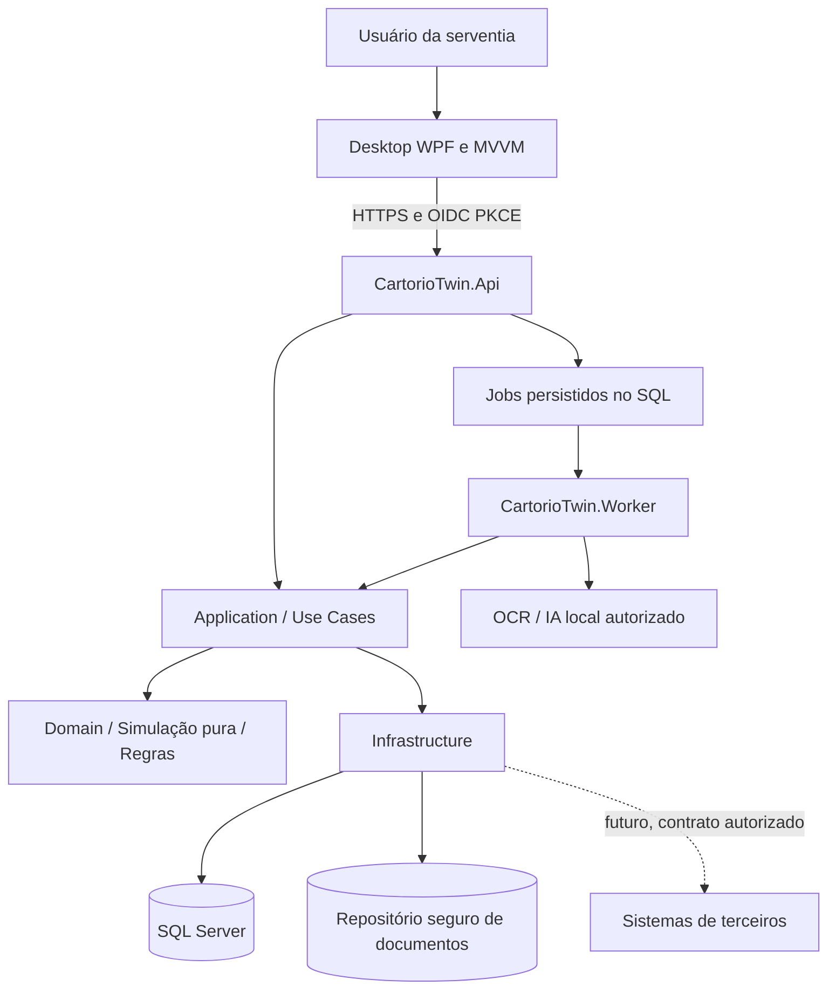

# 02 — Arquitetura C# / WPF / .NET 10

**Versão:** 1.2.0 · **Data:** 15/10/2026 · **Estado:** especificação documental; implementação e homologação pendentes.

## 1. Desenho lógico

O produto é **desktop-first**: WPF é a única interface do MVP. Para um produto comercial com dados sensíveis, a implantação recomendada separa o cliente da persistência e dos documentos via API interna. Isso **não torna a interface Web**; somente a comunicação e os serviços são HTTP locais/intranet.



> **Identidade da baseline:** OIDC Authorization Code + PKCE por navegador do sistema; IdP local/intranet a selecionar e licenciar na Sprint 0. Sem captura de senha do provedor pelo WPF. Access token em memória; refresh token somente se autorizado, protegido por usuário Windows (DPAPI), revogável. API valida emissor, audiência, vínculo e permissões; worker tem identidade técnica sem permissão de revisão humana. Usar `HttpClientFactory`, timeout e cancelamento. Se o ambiente não oferecer IdP, provisioná-lo ou aprovar novo ADR antes de implementar fluxo alternativo.

## 2. Estrutura da solution

```text
CartorioTwin.sln
├─ src/
│  ├─ CartorioTwin.Desktop.Wpf/            # XAML, estilos, viewmodels, composição
│  ├─ CartorioTwin.Desktop.Client/         # Clientes HTTP tipados, DTO mapping
│  ├─ CartorioTwin.Worker/                 # Jobs duráveis; executores isolados de PDF/OCR
│  ├─ CartorioTwin.Api/                    # Endpoints REST, autenticação, políticas
│  ├─ CartorioTwin.Application/            # Casos de uso, DTOs, portas de entrada
│  ├─ CartorioTwin.Domain/                 # Entidades, VO, simulações, regras puras
│  ├─ CartorioTwin.Infrastructure/         # EF Core, documentos, parsers, auditoria
│  └─ CartorioTwin.Contracts/              # Contratos JSON públicos e enums estáveis
├─ tests/
│  ├─ CartorioTwin.Domain.Tests/
│  ├─ CartorioTwin.Application.Tests/
│  ├─ CartorioTwin.Api.IntegrationTests/
│  └─ CartorioTwin.Desktop.ViewModelTests/
├─ docs/                                   # Este pacote de documentação
├─ .github/workflows/                      # Build, testes, análise de segurança
├─ Directory.Build.props
├─ Directory.Packages.props                # Central package management
├─ global.json                             # SDK .NET 10 fixado para build
└─ README.md
```

A referência entre projetos deve obedecer: `Domain` não depende de Application, Infrastructure, API ou WPF; `Application` depende de Domain; `Infrastructure` implementa portas de Application; API e Worker compõem adaptadores de serviço; WPF depende somente de Client/Contracts e componentes visuais. `Contracts` contém DTOs públicos, sem expor entidades EF.

## 3. Decisões práticas e padrões

| Padrão | Uso | Por quê / quando evitar |
|---|---|---|
| Clean Architecture pragmática | Separação de regras, casos de uso, I/O e interface | Permite testar cenário jurídico sem UI/banco. Evitar camadas vazias sem finalidade |
| MVVM | WPF + `CommunityToolkit.Mvvm` | Estado e comandos testáveis; code-behind restrito a comportamentos visuais |
| Strategy + Specification | Simuladores por tipo de operação e regras tipadas | Ampliação sem `switch` central crescente; não carregar regras sem aprovação jurídica |
| Snapshot imutável | Estado documentado fixo por revisão | Permite simulação repetível, comparação e auditoria |
| Repository (restrito) | Agregados `Operacao`, `MatrículaSnapshot`, `Fonte` | Não criar repositório genérico universal; consultas especializadas via projeções |
| Result/ProblemDetails | Erros e validação | Distinguir erros técnicos, conflitos e resultado jurídico-documental inconclusivo |
| Fila transacional SQL no MVP | Job persistido junto à intenção de processamento | Sem broker obrigatório; se broker separado for adotado, outbox entra antes de publicar trabalho |
| CQRS leve | Separar gravação e consultas projetadas | Sem infraestrutura de mensageria/CQRS distribuído no MVP |

## 4. Exemplo de estrutura de domínio

```text
Domain/
  Shared/
    Fracao.cs                     # razão exata, ex. 1/2 e 1/3
    ResultadoValidacao.cs
    ReferenciaEvidencia.cs
  Imoveis/
    ImovelId.cs
    MatriculaReferencia.cs
    MatriculaSnapshot.cs
    Titularidade.cs
    DireitoReal.cs
    OnusDocumentado.cs
  Operacoes/
    Operacao.cs
    CenarioSimulacao.cs
    TransmissaoProposta.cs
    TipoOperacao.cs
  Simulation/
    ISimuladorOperacao.cs
    SimuladorCompraVenda.cs
    EstadoProjetado.cs
    Achado.cs
    RegraContexto.cs
  Rules/
    IRegraConferencia.cs
    RegraDisponibilidadeFracao.cs
    RegraTotalParticipacoes.cs
    RegraSuficienciaEvidencias.cs
```

### Frações: precisão jurídica e matemática

Frações de direitos reais podem representar `1/3`, `2/7` etc. Portanto, **não usar `double`** e não depender de centésimos de percentual (`5000` representa 50%, mas não 1/3 com exatidão). Usar *value object* `Fracao(Numerador, Denominador)`, normalizado por MDC, com denominador positivo, `checked` e limites de capacidade; armazenar numerador/denominador separadamente (ou inteiro de precisão ampliada se validado). Deve preservar operações exatas e só arredondar na apresentação.

Exemplo de contrato ilustrativo:

```csharp
public readonly record struct Fracao(long Numerador, long Denominador);

public sealed record TitularidadeSnapshot(
    Guid PessoaId,
    Fracao Participacao,
    IReadOnlyList<Guid> EvidenciasIds);

public sealed record TransmissaoProposta(
    Guid AlienanteId,
    Guid AdquirenteId,
    Guid MatriculaId,
    Fracao FracaoDoTotal);

public sealed record SolicitarSimulacao(
    Guid OperacaoId,
    Guid CenarioId,
    Guid CenarioRevisaoId,
    Guid SnapshotId,
    string SnapshotHash);
```

**Importante:** `Fracao` acima é apenas a assinatura do tipo. Sua implementação deve normalizar, validar, somar/comparar por aritmética exata, impedir overflow e cobrir propriedades por testes. Nunca salvar instâncias não validadas como fatos.

### Interfaces centrais

```csharp
public interface ISimuladorOperacao
{
    TipoOperacao Tipo { get; }
    ResultadoSimulacao Simular(EntradaSimulacao entrada);
}

public interface IRegraConferencia
{
    string Codigo { get; }
    ResultadoRegra Avaliar(ContextoRegra contexto);
}

public interface IOperacaoRepository
{
    Task<Operacao?> ObterAsync(Guid serventiaId, Guid operacaoId, CancellationToken ct);
    Task SalvarAsync(Operacao operacao, CancellationToken ct);
}

public interface IFonteDocumentalRepository
{
    Task<Stream> AbrirLeituraAsync(Guid serventiaId, Guid fonteId, CancellationToken ct);
    Task<FonteDocumental> SalvarImutavelAsync(
        Guid serventiaId, Stream conteudo, string nome, string mimeType,
        CancellationToken ct);
}

public interface IExtratorDocumento
{
    string FormatoSuportado { get; }
    Task<ExtracaoDocumental> ExtrairAsync(FonteDocumental fonte, CancellationToken ct);
}

public interface ITrilhaAuditoria
{
    Task RegistrarAsync(EventoAuditoria evento, CancellationToken ct);
}
```

**Definição**: as entidades `EntradaSimulacao`, `ResultadoSimulacao`, `ContextoRegra`, `ResultadoRegra`, `Operacao` e `FonteDocumental` são descritas no documento 03; contratos finais devem usar namespaces e tipos concretos coerentes. `ISimuladorOperacao` é preferencialmente **síncrono e puro**, já que recebe um snapshot em memória; I/O fica nos casos de uso antes/depois da simulação.

## 5. Pipeline do caso de uso SimularCenario

```text
POST /api/v1/operacoes/{id}/cenarios/{cenarioId}/simulacoes
    -> AuthZ: autentica usuário e verifica serventia
    -> Obtém operação, fonte(s) e snapshot validado
    -> Verifica concorrência (ETag/RowVersion e hash de entrada)
    -> Verifica pacote de regras aplicável e versionado
    -> Constrói EntradaSimulacao IMUTÁVEL
    -> Regras de evidência e pré-condições
    -> Motor de cálculo por tipo de operação
    -> Regras pós-simulação + achados estruturados
    -> Classificação: divergente / inconclusivo / consistente no escopo
    -> Revalida revisão/manifesto em transação curta na publicação
    -> Persiste execução e auditoria atomicamente; resultado obsoleto não vira corrente
    -> Registra auditoria e retorna DTO com ETag/hash
```

O motor não usa `DateTime.Now`, rede, banco, logging nem geração aleatória. Data da operação e data da análise entram explicitamente em `EntradaSimulacao`. Casos complexos devem preservar temporalidade da fonte e mostrar limites do conhecimento.

## 6. Modelo de resultado

```csharp
public enum StatusAnalise
{
    ConsistenteNoEscopo,
    Divergente,
    Inconclusivo
}

public enum SeveridadeAchado { Informativo, Atencao, Critico }
public enum EstadoExecucaoTecnica { Aguardando, EmExecucao, Concluida, Falhou, Cancelada }
public enum CompletudeDocumental { CompletaNoEscopo, Incompleta, Conflitante }
public enum CoberturaRegras { Tecnica, TecnicaEJuridicaLimitada }
public enum ValidadeResultado { Corrente, Desatualizada }

public sealed record AchadoDto(
    string CodigoRegra,
    string VersaoRegra,
    SeveridadeAchado Severidade,
    string Mensagem,
    IReadOnlyList<Guid> Evidencias,
    bool ExigeRevisaoHumana);

public sealed record SimulacaoDto(
    Guid ExecucaoId,
    StatusAnalise Status,
    EstadoExecucaoTecnica EstadoTecnico,
    CompletudeDocumental Completude,
    CoberturaRegras Cobertura,
    ValidadeResultado Validade,
    string HashEntradas,
    string VersaoPacoteRegras,
    DateTimeOffset ExecutadaEmUtc,
    IReadOnlyList<AchadoDto> Achados,
    EstadoProjetadoDto? Projetado);
```

Classificação agregada e eixos independentes seguem 03, seção 4: divergência confirmada tem precedência, mas lacunas continuam explícitas; ausência de verificação mínima produz inconclusivo. `NaoAplicavel` existe somente no resultado da regra. DTOs devem incluir situação técnica, completude, cobertura e validade temporal conforme 10. Nenhum desses eixos significa aprovação jurídica.

## 7. API interna — baseline

| Método | Endpoint | Função | Permissão |
|---|---|---|---|
| `GET` | `/api/v1/operacoes` | Busca paginada + filtros | leitor |
| `POST` | `/api/v1/operacoes` | Cria rascunho | operador |
| `GET` | `/api/v1/operacoes/{id}` | Detalhe + versão | leitor |
| `PATCH` | `/api/v1/operacoes/{id}` | Atualiza com `If-Match` | operador |
| `POST` | `/api/v1/operacoes/{id}/fontes` | Upload de fonte | operador |
| `GET` | `/api/v1/operacoes/{id}/fontes/{fonteId}` | Download autorizado | leitor |
| `POST` | `/api/v1/operacoes/{id}/snapshots/{snapshotId}/aprovacoes` | Portão B sobre versão/hash exatos | revisor |
| `POST` | `/api/v1/operacoes/{id}/cenarios` | Cria hipótese | operador |
| `POST` | `/api/v1/operacoes/{id}/cenarios/{cenarioId}/simulacoes` | Simula | revisor/operador autorizado |
| `GET` | `/api/v1/operacoes/{id}/simulacoes/{execucaoId}` | Resultado imutável | leitor |
| `POST` | `/api/v1/achados/{id}/revisoes` | Anota revisão humana | revisor |
| `POST` | `/api/v1/operacoes/{id}/simulacoes/{execucaoId}/dossies` | Emite artefato imutável da execução explícita | revisor |
| `GET` | `/api/v1/operacoes/{id}/dossies/{dossieId}` | Download autorizado, histórico rotulado quando necessário | revisor/leitor autorizado |
| `GET` | `/api/v1/auditoria` | Pesquisa rastros permitidos | administrador/auditor |

**Exemplo de payload (simulação):**

```json
{
  "cenarioRevisaoId": "11111111-1111-4111-8111-111111111111",
  "snapshotId": "22222222-2222-4222-8222-222222222222",
  "snapshotHash": "sha256:HASH_DO_SNAPSHOT"
}
```

O servidor carrega os movimentos da revisão imutável do cenário; não aceita proposta diferente escondida na solicitação de execução. Hash ilustrativo deve ser substituído por 64 dígitos hexadecimais em fixtures. UUIDs são sintéticos. Contratos de criação de revisão, fração do total, jobs e idempotência estão em 10. Serventia deriva do vínculo autenticado, nunca da confiança em um campo enviado. Limite inicial: 25 MiB por arquivo, sujeito ao benchmark e à política documentada.

### Erros HTTP

- `400`: sintaxe/payload inválido; `401`: usuário não autenticado; `403`: sem permissão; `404`: não encontrado **ou fora do escopo da serventia**; `409`: dependência obsoleta ou chave idempotente com outro payload; `412`: `If-Match` não confere; `428`: precondição de escrita ausente; `413`: arquivo grande; `415`: formato não aceito; `422`: operação sem pré-condições para execução; `429`: limite de taxa; `500`: erro inesperado com `traceId` sem dados sensíveis.
- **Divergência jurídica-documental é resultado funcional `200/201` com achados, não erro HTTP.**

## 8. WPF e ciclo de vida

- `TargetFramework` do desktop: `net10.0-windows`; `UseWPF=true`.
- `Microsoft.Extensions.Hosting` para DI, logging e ciclo de vida do aplicativo.
- `CommunityToolkit.Mvvm`: `ObservableObject`, `ObservableProperty`, `RelayCommand`, `AsyncRelayCommand`, validação em viewmodels.
- Chamadas assíncronas com `CancellationToken`; processamento pesado fora da thread de interface.
- `ICommand` e validações para estados `CanExecute`; **nada de regra jurídica no code-behind**.
- ResourceDictionaries para tokens/controles/telas separados; vide `04_DESIGN_WPF.md`.
- Publicação assinada; instalador corporativo (MSIX ou MSI a definir após testes no parque Windows). Atualização controlada pela serventia.

## 9. Implantação e ambientes

**Desenvolvimento:** Visual Studio compatível com .NET 10, SDK pinado, SQL Server Developer ou ambiente de testes efêmero. **Piloto:** serviço API + SQL Server Express/Standard em servidor ou máquina designada pela serventia, WPF instalado em estações autorizadas. **Produção:** API por HTTPS com certificado válido em rede controlada, autenticação e políticas de backup, restore, retenção, updates e monitoramento.

Não embutir credenciais de banco no WPF. Mesmo no piloto local a aplicação desktop comunica-se com API. Planejar múltiplas serventias por `TenantId`, com **isolamento lógico comprovado por testes**; instalações fisicamente separadas por serventia são opção mais conservadora.

## 10. Sequência de implementação do domínio

1. Criar tipos `Fracao`, `PessoaId`, `MatriculaReferencia`, `TitularidadeSnapshot` e casos de teste determinísticos.
2. Implementar `SimuladorCompraVenda` puro, com execução **atômica**: inconsistência impede produzir projeção completa enganosa.
3. Construir orquestração com versionamento de snapshot e auditoria.
4. Expor endpoints e implementar UI WPF; usar dados sintéticos até aprovar segurança.
5. Integrar extração/OCR, interpretação, revisão e reconstrução **dentro do MVP**. Antecipar fatia técnica PDF → revisão → estado → simulação até Sprint 5; UI completa na 6, integração final na 8.

## 11. Pontos a validar na Sprint 0

Topologia de implantação (um serviço por serventia versus multitenant), identidade, banco/licenciamento, Windows mínimo, política de guarda de documentos, formatos prevalentes e regras estaduais prioritárias. O motor puro pode ser desenvolvido com fixtures; a integração e o piloto dependem dessas decisões. Os protocolos executáveis e modelos lógicos estão em 10; operação e benchmark em 11.

## 12. Organização modular e implantação

`DocumentIntelligence` recebe fontes e produz candidatos/evidências; adapters PDF/OCR/IA ficam na Infrastructure. `RegistryState` aplica eventos revisados e produz estado/linhagem/lacunas. `LegalSimulation` calcula proposta condicional sobre snapshot revisado. Os dois últimos motores são puros; orquestração, persistência e publicação estão em Application/Infrastructure. Não são três microserviços nem três bancos.

API e Worker são hosts separados na baseline recomendada, com banco operacional e storage protegidos compartilhados. Extração potencialmente hostil roda em subprocesso isolado, sem tokens de usuário ou conexão de banco. Worker coordena artefatos e dados com mínimos privilégios. A fila SQL é durável; processo em memória apenas sinaliza disponibilidade. Topologia final, IdP e licenciamento são gates da Sprint 0 (ADR-003/012/014).
