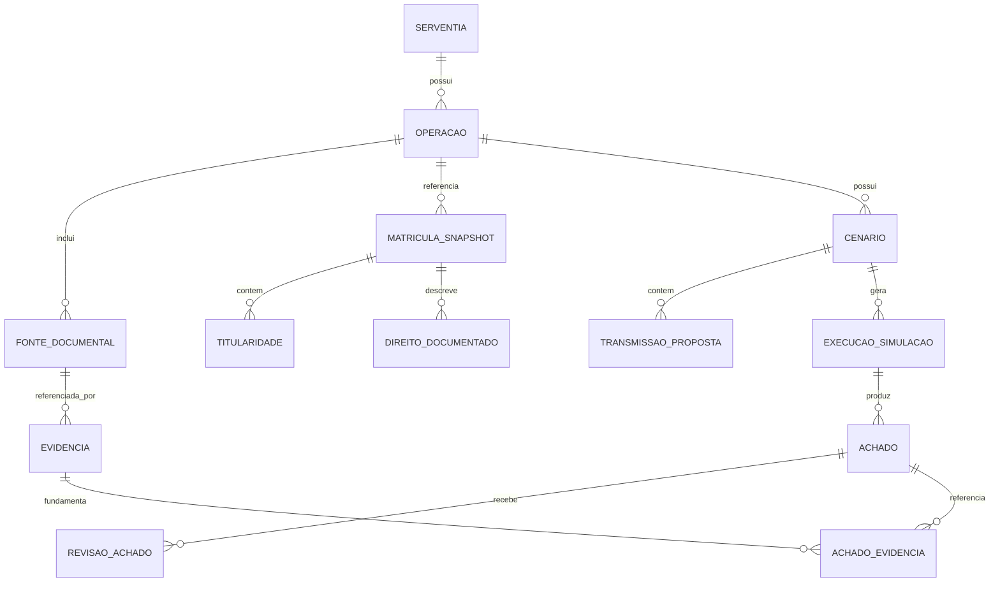
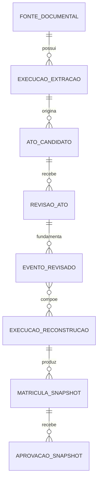

# 03 — Domínio, regras e simulações

**Versão:** 1.2.0 · **Data:** 15/10/2026 · **Estado:** especificação documental; implementação e homologação pendentes.

## 1. Conceitos e terminologia

| Conceito | Definição neste produto |
|---|---|
| Matrícula de referência | Identificação do imóvel e da serventia conforme a fonte apresentada |
| Fonte documental | Documento imutável enviado ao sistema, com hash, origem, emissor e data quando conhecidos |
| Fato documental | Informação explicitamente localizada em uma fonte; **não garante** atualidade ou validade externa |
| Snapshot revisado | Conjunto fixo de fatos conferidos para simulação, identificados por versão e hash |
| Situação atual documentada | Estado que **consta das fontes analisadas**, não necessariamente a situação registral oficial atual |
| Operação pretendida | Negócio informado, ainda não consumado nem registrado pelo Cartório Twin |
| Cenário | Hipótese de operação (A, B etc.) com movimentos próprios e entradas fixadas |
| Estado projetado | Resultado matemático/documental condicional segundo as regras executadas |
| Achado | Divergência, ausência, advertência ou informação com regra e evidência |
| Revisão | Registro **separado** da avaliação humana de um dado ou achado |
| Regra | Verificação versionada, com escopo temporal, jurisdicional e referências normativas |

## 2. Agregados e relacionamentos

### Entidades propostas

- `Serventia`: `Id`, `Nome`, `UF`, `Especialidades`, `Ativa`, políticas de isolamento e retenção.
- `Operacao`: `Id`, `ServentiaId`, `Tipo`, `EstadoWorkflow`, `CriadaEmUtc`, `AtualizadaEmUtc`, `VersaoConcorrencia` e vínculo aos cenários.
- `FonteDocumental`: `Id`, `OperacaoId`, `NomeOriginalSanitizado`, `Sha256`, `MimeTypeValidado`, `TamanhoBytes`, `Origem`, `DataEmissao?`, `CapturadaEmUtc`, `EstadoRevisao`.
- `MatriculaSnapshot`: `Id`, `MatriculaReferencia`, `Fontes[]`, `DataFonte?`, `NumeroVersao`, `SnapshotHash`, `RevisadaPor`, `RevisadaEmUtc`.
- `Titularidade`: `PessoaReferenciaId`, `TipoDireito`, `Fracao`, `Evidencias[]`, `SituacaoEvidencia`.
- `DireitoDocumentado`: tipo, titulares, extensão, início/fim documentados se disponíveis, evidência; **separado** de participação na propriedade.
- `Cenario`: `Id`, `OperacaoId`, `Nome`, `Versao`, `SnapshotId`, `SnapshotHashUtilizado`, `RevisoesImutaveis[]`, `StatusRascunho`.
- `TransmissaoProposta`: `AlienanteId`, `AdquirenteId`, `MatriculaReferencia`, `Fracao`, `TipoDireitoTransmitido` e contexto da proposta.
- `ExecucaoSimulacao`: `Id`, `CenarioId`, `HashEntradas`, `VersaoRegras`, `Status`, `Projecao?`, `CriadaEmUtc`.
- `Achado`: `Codigo`, `Severidade`, `Mensagem`, `FatosContrapostos`, `Evidencias[]`, `RegraId/Versao`, `Avaliacao?`.
- `RevisaoAchado`: `Id`, `AchadoId`, `UsuarioId`, `Classificacao`, `Justificativa`, `EmUtc`. **Nunca sobrescrever o achado gerado**.

Pessoas são referenciadas por `PessoaReferenciaId` e atributos documentais vinculados às respectivas fontes; usar nomes apenas como exibição, **nunca** como chave de identidade ou prova automática de igualdade de pessoas. Mesmo CPF semelhante/igual, homonímia e alterações documentais precisam de conferência contextual.

A cadeia documental é detalhada separadamente para não confundir sugestão e fato confirmado:

Relações N:M, campos e constraints físicos seguem 10; o diagrama é uma visão dos agregados, sem substituir o catálogo lógico.

## 3. Estados da operação

```mermaid
stateDiagram-v2
    [*] --> Rascunho
    Rascunho --> EmConferencia : anexar/cadastrar fontes
    EmConferencia --> RevisaoConcluida : Portao B concluido; completude explicita
    RevisaoConcluida --> Simulada : motor executado
    Simulada --> EmConferencia : documento ou fato alterado
    Simulada --> Simulada : novo cenario/nova execucao
    Simulada --> Encerrada : revisao humana + dossie
    EmConferencia --> Cancelada : usuario autorizado
    Rascunho --> Cancelada
```

**Regra:** toda alteração relevante em documento, titularidade, fração, relação ou pacote ativo incrementa a revisão da operação e torna dependentes `DESATUALIZADOS` em metadados separados; a execução original permanece imutável. No MVP, adotar invalidação conservadora da operação para qualquer inclusão/substituição de fonte ou revisão de candidato já confirmado. Não deletar relatórios anteriores automaticamente; mostrar versão/hash e obrigar nova simulação para dossiê atual.

## 4. Matriz do resultado e eixos independentes

| Eixo | Valores | Significado |
|---|---|---|
| Execução técnica | Aguardando, EmExecucao, Concluida, Falhou, Cancelada | Progresso técnico; falha não é divergência documental |
| Conclusão da análise | Divergente, Inconclusivo, ConsistenteNoEscopo | Somente quando há resultado funcional |
| Completude | CompletaNoEscopo, Incompleta, Conflitante | Estado das evidências; aprovação humana não apaga lacunas |
| Cobertura | Tecnica, TecnicaEJuridicaLimitada | Regras realmente executadas, tipos/UF/vigência |
| Validade temporal | Corrente, Desatualizada | Metadado separado do resultado imutável |

Classificação em ordem: (1) divergência **confirmada por dados revisados suficientes para aquele achado** → `DIVERGENTE`, mesmo com outras lacunas, preservando completude incompleta/conflitante; (2) sem divergência confirmada, falta de fonte essencial, evento relevante não suportado, conflito não resolvido ou regra mínima não executada → `INCONCLUSIVO`; (3) somente entradas suficientes e verificações mínimas concluídas sem divergência → `CONSISTENTE_NO_ESCOPO`. `NaoAplicavel` é resultado individual da regra, nunca conclusão agregada. Conjunto de verificações vazio não produz consistente.

Projeção completa somente com conclusão consistente no escopo, completude suficiente para propriedade e nenhum efeito relevante desconhecido. Nos demais casos é nula; não exibir estado parcial. Rascunho/hipótese sem fonte pode ser anotado separadamente, sem projeção oficial do motor no MVP.

O conjunto mínimo de compra e venda inclui RT-001…RT-010, registrando para cada uma `Executada`, `NaoAplicavel` justificada ou `NaoExecutada` com motivo. Evidência, integridade, disponibilidade e revisão/hash são verificações obrigatórias que não podem ser todas dispensadas. Regra jurídica ausente não bloqueia modo técnico, mas seu limite é persistente no cabeçalho e no dossiê. Ausência de regra técnica mínima bloqueia consistência.

`CRITICO`, `ATENCAO` e `INFORMATIVO` são severidades de achado; não representam aptidão jurídica. Sem snapshot revisado não iniciar simulação publicada (422); snapshot revisado como incompleto pode ser analisado para produzir inconclusivo. Mesma distinção vale para CT-005.

## 5. Regras determinísticas do MVP

| Código | Pré-condição / lógica | Saída | Base / status jurídico |
|---|---|---|---|
| RT-001 | Movimento com denominador > 0 e 0 < numerador/denominador <= 1 | Rejeita transmissão inválida; saldo zero é permitido no value object | Regra matemática de integridade |
| RT-002 | Partes revisadas e distintas | Mesma identidade confirmada → divergente; qualificação essencial não resolvida → inconclusivo | Regra de consistência estrutural, não juízo jurídico |
| RT-003 | Alienante consta como titular da **mesma categoria de direito**, segundo snapshot revisado | Ausente em quadro completo revisado → divergente; cadeia/quadro insuficiente → inconclusivo | Comparação documental; análise humana obrigatória |
| RT-004 | `SomaDasFracoesTransmitidasPeloAlienante <= FracaoDisponivel` | Divergente se excesso | Regra de disponibilidade matemática; não substitui disponibilidade jurídica |
| RT-005 | Somatória de frações de **propriedade plena** = 1 quando quadro completo declarado | Quadro completo e soma diferente de 1 → divergente; quadro incompleto e soma <= 1 → inconclusivo; soma > 1 → divergente | Integridade documental |
| RT-006 | Comprador pode já possuir fração | Soma exata após transmissão | Regra matemática |
| RT-007 | Transmissões na mesma simulação são **atômicas** | Sem projeção parcial se uma falhar | Regra técnica de simulação |
| RT-008 | Portão B concluído para versão/hash solicitados; evidências/completude explícitas | Sem revisão → 422; revisão obsoleta → 409; revisado mas incompleto → análise inconclusiva sem projeção | Governança de evidência |
| RT-009 | Pacote técnico aprovado obrigatório; pacote jurídico só se homologado e aplicável | Sem técnico → 422; sem jurídico → modo técnico rotulado, sem afirmação de cobertura jurídica | Governança técnica/normativa |
| RT-010 | Capturar data/emissor de fonte; advertir se data não conhecida | Atenção/inconclusivo conforme política da serventia | Política local parametrizável |

**Nota:** a Lei nº 6.015/1973 e o Código Civil fundamentam a necessidade de tratar continuidade e efeitos do registro com rigor. O MVP **não implementa** uma decisão completa sobre continuidade registral; implementa verificações de consistência e disponibilidade de fração documental. Referências jurídicas estão no README e devem ser associadas a regras futuras individualmente.

## 6. Simulações de referência

### CT-001 — Fração insuficiente

- Matrícula documental X: João = 1/2; Maria = 1/2.
- Proposta: João → Carlos = 1/1.
- Esperado: `DIVERGENTE`, `RT-004`, evidência João 1/2, alegação de venda 1/1, nenhuma projeção concluída.

### CT-002 — Venda de fração válida no modelo

- Base igual a CT-001, fonte conferida.
- Proposta: João → Carlos = 1/2.
- Esperado: `CONSISTENTE_NO_ESCOPO`; projeção Maria = 1/2; Carlos = 1/2; João = 0; base permanece imutável.

### CT-003 — Venda conjunta de 100%

- Propostas: João → Carlos = 1/2; Maria → Carlos = 1/2.
- Esperado: projeção Carlos = 1/1; sem parcialidade; reexecução idêntica.

### CT-004 — Teste de terços (precisão)

- Base: A = 1/3; B = 1/3; C = 1/3.
- Propostas: A → D = 1/3, B → D = 1/3.
- Esperado: D = 2/3; C = 1/3; resultado **exato**; nunca 0,666666 arredondado como estado jurídico.

### CT-005 — Falta de fonte para um titular

- Base capturada: João = 1/2; outra metade **não identificada**.
- Proposta: João → Carlos = 1/2.
- Esperado: **inconclusivo** quanto à situação global; pode exibir simulação local *hipotética* apenas em aba separada, sem certificado de estado completo.

### CT-006 — Nome semelhante não é identidade

- Fonte A: “João da Silva”; fonte B: “João Silva”.
- Esperado: sistema pede vinculação/revisão de identidade, **não** funde titulares automaticamente.

### CT-007 — Mudança de fonte após simulação

- Simulação aceita no escopo com snapshot versão 1.
- Usuário substitui a informação de titularidade com nova fonte (versão 2).
- Esperado: simulação versão 1 permanece histórica, marcada `DESATUALIZADA`; dossiê vigente exige nova execução.

### CT-008 — Um movimento inválido em lote

- Base: João 1/2, Maria 1/2; movimentos: João → Carlos 1/2 e Maria → Carlos 3/4.
- Esperado: `DIVERGENTE`, **nenhum** efeito parcial; fonte de cada mensagem identificada.

## 7. Regras futuras (não ativas no MVP)

| Código | Domínio | Risco central | Marco |
|---|---|---|---|
| RFJ-101 | Outorga conjugal/regime de bens | Requisitos legais e exceções dependem de contexto | P2 |
| RFJ-102 | Procuração/representação | Poderes específicos e extensão documental | P2 |
| RFJ-103 | Continuidade registral | Cadeia de atos e documentos anteriores | P2 |
| RFJ-104 | Usufruto/nua-propriedade | Direitos diferentes não são percentuais concorrentes | P2 |
| RFJ-105 | Alienação fiduciária | Titularidade fiduciária, garantia e caminhos legais específicos | P2 |
| RFJ-106 | Permuta | Vários imóveis/partes/atos e condicionamentos | P2 |

Cada regra futura exige: `Identificador`, `Versao`, `DataEfetiva`, `Jurisdição`, `Especialidade`, `Hipóteses`, `Exceções`, `ReferênciasNormativas`, `TestesPositivosNegativos`, `AprovadoPor`, `AprovadoEm` e `Ativo`.

## 8. Regras de evolução do motor

- **Função pura:** `Simular(snapshot, proposta, pacoteRegras, instanteAnalise)` devolve resultado sem I/O.
- **Imutabilidade:** `Snapshot` nunca é mutado; resultado gerado como novo objeto; não há alterações reais de direitos no sistema oficial.
- **Ordem:** validar integridade e evidência; validar cada movimento; calcular projeção em memória; executar verificações pós-simulação; classificar e calcular hash do conteúdo; assinatura, se adotada, é controle separado.
- **Conflitos:** resultados com dados incompletos não podem ser promovidos silenciosamente a consistentes.
- **Reprodutibilidade:** persistir `snapshotHash`, entradas, versão exata do motor, versão de regra e data lógica; execução deve ser reproduzível.
- **Versões concorrentes:** hash/ETag e comparação transacional de revisão na publicação impedem promoção de saída sobre base alterada; verificar somente no início não basta.
- **Temporalidade:** diferenciar data do documento, data de apresentação, data do ato, data da certidão e data da análise; não presumir equivalência.

## 9. Critérios para ativar uma regra jurídica

Apenas após aprovação de especialista da serventia/painel jurídico, referência oficial auditável, testes de borda, atualização das normas locais e aceite funcional. Recomenda-se que a primeira versão contenha apenas regras RT-001 a RT-010 e use a expressão `CONSISTENTE_NO_ESCOPO` em todos os relatórios, nunca `APTO PARA REGISTRO`.

## 10. Semântica obrigatória de frações e movimentos

A API armazena somente `FracaoDoTotal` da propriedade na matrícula. `BaseFracao = TotalDoDireitoNoImovel` é explícita e a única suportada no MVP. O formulário pode auxiliar a conversão de “metade da quota de 1/2” em `1/4`, exibindo cálculo e exigindo confirmação antes de salvar; frases ambíguas não são aceitas como movimento confirmado. `Fracao` admite zero para saldos; transmissão exige `0 < f <= 1`; denominador positivo, normalização por MDC e rejeição controlada de overflow antes de persistir. Armazenar inteiros de 64 bits; aritmética intermediária exata pode usar BigInteger e só converter após verificar capacidade.

Movimentos da mesma proposta são simultâneos contra o snapshot inicial. Somar saídas por `(MatriculaId, PessoaId, TipoDireito)` e comparar com saldo inicial. Aquisição no mesmo lote não financia nova saída: A→B e B→C, com B sem participação inicial, é divergente por RT-004. Simulações encadeadas exigem evolução explícita pós-MVP. Entrada de mesmo titular em várias linhas só é agregada após identidade/categoria revisadas; aquisições duplicadas de fontes sobrepostas não podem ser somadas como novas.

MVP simula somente propriedade plena numa matrícula. Ônus, usufruto e garantias são fatos tipados separados; efeito relevante ainda não resolvido mantém incompletude/inconclusão. Não deduzir ausência de ônus porque o parser não encontrou menção.

## 11. Atos, eventos e reconstrução

`AtoCandidato` mantém texto/extração, sugestões e evidências; `RevisaoAto` fixa campos aceitos/corrigidos e identidade; `EventoRevisado` descreve efeito suportado com versão de mapeamento, pré-condições e alvos. Reconstrução recebe eventos com IDs de revisão fixados, aplica a ordem documental revisada e produz estado, lacunas e linhagem por fato. Uma mudança cria nova revisão/reconstrução; não edita evento histórico. Ver estruturas e constraints em 10.

Deduplicação exige contexto de matrícula/serventia e correspondência revisada entre fontes; `R-5` sozinho não é chave global. Reimportação idêntica reaproveita conteúdo, não reaplica transferência. Certidões diferentes podem sobrepor atos; até resolver correspondência/conflito, a cadeia é inconclusiva. Um salto numérico é indício para conferência, não prova isolada de folha ausente.

| Evento | Pré-condição | Efeito suportado / falha |
|---|---|---|
| Abertura documental | Matrícula e descrição revisadas | Inicia contexto; não inventa participação anterior |
| Transmissão suportada | Partes, direito, fração, origem disponível e mapeamento revisados | Debita/credita exatamente; lacuna mantém estado incompleto |
| Qualificação alterada | Pessoa/ato alvo vinculados por revisão | Acrescenta atributo versionado; não funde identidades por nome |
| Ônus/garantia mencionado | Evidência revisada | Registra fato e extensão conhecida; disponibilidade jurídica não presumida |
| Cancelamento mencionado | Ato alvo, alcance e regra de efeito revisados | No MVP sinaliza alcance/ambiguidade; não extingue direito automaticamente sem regra aprovada |
| Retificação/outro ato | Texto preservado e relevância analisada | Registra lacuna/impacto; efeito não suportado não é omitido |

Mapeamento de efeito registral exige revisão especializada correspondente, mesmo quando o simulador opera só com pacote técnico. Inferir efeito a partir de narrativa sem regra/revisão é proibido.
