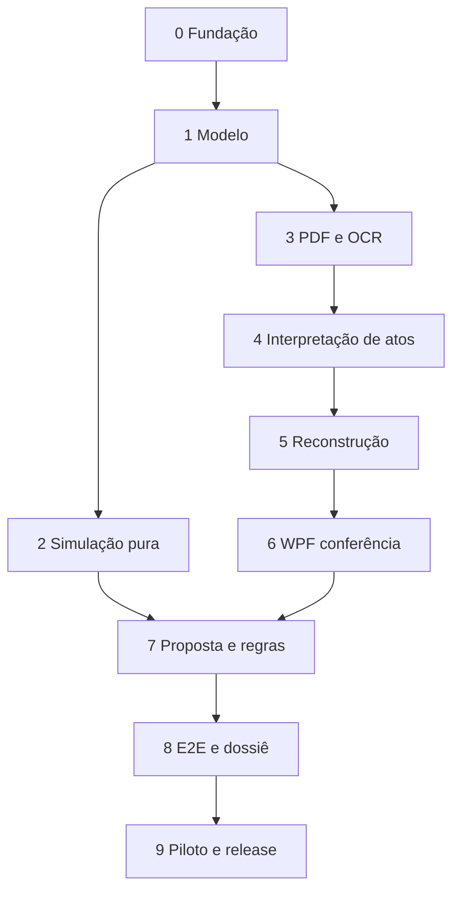

# 07 — Roadmap revisado: sprints, tasks e gates

**Versão:** 1.2.0 · **Consolidação autorizada:** 15/10/2026 · **Estado:** planejamento, sem sprints implementadas.

## 1. Direção aprovada e consequência para o planejamento

O **MVP não é um simulador alimentado somente por digitação manual**. O fluxo mínimo demonstrável é:

`Matrícula PDF → extração de texto/OCR → interpretação assistida de atos → revisão humana → reconstrução de estado documentado → negócio pretendido → regras e simulação → dossiê de evidências`.

A digitação manual permanece como **contingência e correção supervisionada**, não como experiência principal. A IA gera hipóteses estruturadas; **nunca cria fatos confirmados** sem revisão. Não há promessa de interpretar universalmente todas as matrículas brasileiras nem de atestar situação registral oficial atual.

### MVP vertical por especialidade

- **Registro de Imóveis:** importação de uma certidão de matrícula PDF, extração nativa/OCR, reconhecimento de atos selecionados, reconstrução de quadro de titularidades e situações relevantes *documentadas*, validação do estado por conferente, simulação de compra e venda de fração e dossiê.
- **Tabelionato de Notas:** mesma operação, com inserção de proposta/minuta e comparação de titulares, qualificações e frações quando os campos puderem ser extraídos e revisados; não produzir escritura nem aprovar registro automaticamente.
- **Cobertura inicial explícita:** abertura da matrícula, aquisição/transmissão de propriedade por atos suportados, identificação de averbações de alteração de qualificação, registros de garantias/ônus e referências a cancelamentos **como fatos a conferir**. Atribuir efeitos jurídicos automáticos a cancelamentos, restrições e direitos complexos somente quando regra estiver validada para esse tipo de evento. Outros atos → `NÃO SUPORTADO/INCONCLUSIVO`, com encaminhamento humano.

**Stack confirmada:** C#, WPF, .NET 10. **Proposta mantida para validação técnica:** API ASP.NET Core 10, SQL Server/EF Core 10, MVVM e módulos separados. A implantação e o provedor de OCR/IA dependem de avaliação do ambiente piloto e dos controles LGPD.

## 2. Backlog por valor e dependências

| Faixa | Prioridade | Definição |
|---|---|---|
| P0 | Obrigatória no MVP | PDF/OCR, atos estruturados, evidências, revisão, estado documentado, operação pretendida, simulação, dossiê, segurança |
| P1 | Após aceitação do MVP | Extração mais ampla de minutas, novos tipos documentais, melhorias de interpretação e produtividade |
| P2 | Produto ampliado | Simulação jurídica aprofundada de usufruto, alienação fiduciária, permuta e conectores autorizados |

| Sprint | Objetivo e resultado concreto | Gate de aceite |
|---|---|---|
| 0 | Descoberta, repositório, infra, segurança, escopo do corpus | G0: corpus autorizado, benchmark, limiares quantitativos e cobertura definidos |
| 1 | Modelo de matrícula, atos, direitos, fontes e evidências | G1: domínio, persistência, autorização e hashes testados |
| 2 | Motor determinístico de transmissão com dados de teste | G2: cenários CT-001…004 e CT-008 aprovados |
| 3 | Importação PDF, texto nativo, OCR, jobs e versionamento | G3: texto/OCR, jobs duráveis, contenção e retomada com proveniência |
| 4 | IA/parsers identificam e estruturam atos com evidências | G4: saída verificável; nenhum fato da IA é promovido sem revisão |
| 5 | Reconstrução de estado registral documentado, com lacunas | G5: replay, publicação concorrente e fatia técnica integrada; lacunas explícitas |
| 6 | WPF completo para importação, extração e revisão de atos | G6: conferente conclui revisão no fluxo visual |
| 7 | Negócio pretendido, minuta e conferências normativas limitadas | G7: proposta e regras rastreáveis; incompatibilidades detectadas |
| 8 | Integração completa de simulação, dossiê, evidência clicável e hardening | G8: PDF → simulação → relatório ponta a ponta |
| 9 | Testes piloto, avaliação jurídica, segurança, instalação e release | G9: evidências de aceite e decisão go/no-go |

**Cadência de referência:** 2 semanas/sprint, ajustável pelo time após Sprint 0. Não há estimativa fechada de prazo porque OCR e heterogeneidade documental podem alterar o esforço.

## 3. DoD comum para toda task

Task só pode ser concluída se: artefatos/código rastreiam RF/RNF; testes passam; revisão de segurança/dados pessoais está registrada; UX é validada quando aplicável; documentação/ADRs refletem decisões; existe PR ou registro equivalente com revisão; todo exemplo utiliza dados sintéticos; build é reproduzível. Regras jurídicas exigem aceite por profissional competente. **Não criar commits fictícios nem afirmar build/teste antes de executá-los.**

## Sprint 0 — Fundação e validação do problema

**Resultado:** critérios do piloto, arquitetura executável mínima e repositório preparado.

| Task | Prioridade | Descrição / entregável | Dependências | Critério de aceite |
|---|---|---|---|---|
| S0-T01 | P0 | Entrevistar ≥2 RI e ≥2 TN; mapear matrículas, fluxo de conferência e complexidade dos atos | Nenhuma | Relatório de descoberta com 5 principais dores e 3 fluxos validados |
| S0-T02 | P0 | Montar corpus autorizado de PDFs textuais e escaneados; gerar versões sintéticas anotadas | S0-T01 | Matriz de documentos por formato, qualidade, tipos de atos e direitos; sem dados reais no Git |
| S0-T03 | P0 | Delimitar catálogo de atos suportados, não suportados e riscos legais por UF | S0-T01 | Matriz de cobertura assinada por revisores do RI/TN; ausências classificadas |
| S0-T04 | P0 | Criar repositório privado, solution .NET 10, projetos, SDK fixo e CI | Nenhuma | Restore/build/test smoke no agente Windows; secrets scan e PR configurados |
| S0-T05 | P0 | Definir arquitetura local/intranet, autenticação, ACL, retenção, backup e política de IA | S0-T01 | ADR de implantação e avaliação preliminar de privacidade aprovados |
| S0-T06 | P0 | Criar contratos versionados para fatos, atos, evidências e revisão; padrão do golden dataset | S0-T02/S0-T03 | JSON schemas rascunho + 5 fixtures de matrícula/simulações |
| S0-T07 | P0 | Protótipos XAML das telas Importar, Revisar Atos, Estado e Simular | S0-T01 | Caminho crítico testado por usuário de RI e TN |

### Tasks adicionais obrigatórias desta baseline

| Task | Prioridade | Descrição / entregável | Dependências | Critério de aceite |
|---|---|---|---|---|
| S0-T08 | P0 | Benchmark local de PDF/OCR/IA e visualizador, hardware e licenças | S0-T02/S0-T05 | Versões, capacidade, limites de recurso, custos e alternativa em falha registrados; sem cloud automático |
| S0-T09 | P0 | Plano de avaliação independente e metas operacionais | S0-T02/S0-T03/S0-T08 | Estratos/amostra, recall, exatidão, tempo humano, custo, RTO/RPO quantitativos aprovados antes da avaliação |
| S0-T10 | P0 | Matriz normativa e política de pacotes técnicos/jurídicos | S0-T03/S0-T05 | Técnico aprovado para testes; mapeamentos de efeitos revisados; normas não verificadas bloqueadas; responsável por pendência |

**Riscos:** acesso a corpus, variados padrões de certidão, licenças de PDF/OCR, contratação de IA. **Gate G0:** proibir uso operacional até matriz de cobertura e política de dados estarem explícitas.

## Sprint 1 — Modelo registral e cadeia de evidências

**Resultado:** domínio tipado e rastreável, sem dependência da UI, banco ou modelos de IA.

| Task | Prioridade | Descrição / entregável | Dependências | Critério de aceite |
|---|---|---|---|---|
| S1-T01 | P0 | `Fracao` exata, identidades de pessoa, imóvel, matrícula e serventia | S0-T04 | Normalização, 1/3 exato, limites e overflow cobertos por teste |
| S1-T02 | P0 | `FonteDocumental`, `TrechoEvidencia`, `Pagina`, `VersaoFonte` e hashes | S0-T06 | Referência liga valor a PDF, página e trecho; sem texto inventado |
| S1-T03 | P0 | `AtoRegistral`, tipo R/AV, identificação, datas distintas, partes, relações entre atos | S1-T02 | Atos preservam ordem e incerteza, sem confundir data do documento e registro |
| S1-T04 | P0 | `DireitoDocumentado`, titularidade, extensão, ônus, status de efeito/desconhecido | S1-T01/S1-T03 | Propriedade e usufruto não são somados como a mesma categoria |
| S1-T05 | P0 | Estados `Extraido`, `EmRevisao`, `Confirmado`, `Contestado`, `NaoSuportado` | S1-T02/S1-T04 | Somente revisões autorizadas promovem fatos confirmados |
| S1-T06 | P0 | Testes de integridade e serialização versionada | S1-T01…05 | Round-trip preserva evidências e relações; domínio não depende de WPF/EF |

### Tasks adicionais obrigatórias desta baseline

| Task | Prioridade | Descrição / entregável | Dependências | Critério de aceite |
|---|---|---|---|---|
| S1-T07 | P0 | Modelagem física, DbContext, migrations e constraints do catálogo de 10 | S0-T06/S1-T06 | Atos/revisões/extrações/jobs e evidências N:M persistem após restart; FKs preservam contexto |
| S1-T08 | P0 | OIDC/PKCE, perfis/policies, contas de serviço e storage autorizado | S0-T05/S1-T07 | API nega acesso cruzado, refresh protegido e worker sem permissão de aprovar fatos |
| S1-T09 | P0 | Manifesto/canonicalização v1 e revisão lógica da operação | S0-T06/S1-T02/S1-T06 | Golden fixtures de hash; atualização explícita do pai em mudança relevante de filho |

**Riscos:** reduzir atos a texto livre; sobrecarregar modelo com inferência da IA. **G1:** separação explícita entre *texto extraído*, *fato candidato*, *fato revisado* e *estado reconstruído*.

## Sprint 2 — Núcleo de simulação matemática/documental

**Resultado:** cálculo seguro e reproduzível sobre snapshots sintéticos/revisados; **ainda sem entrada por PDF**.

| Task | Prioridade | Descrição / entregável | Dependências | Critério de aceite |
|---|---|---|---|---|
| S2-T01 | P0 | `ISimuladorOperacao`, `EntradaSimulacao`, `ResultadoSimulacao` imutáveis | S1-T04 | Execução não altera snapshot original |
| S2-T02 | P0 | RT-001…RT-010 para frações, identidades e evidências | S1-T05/S2-T01 | Regras com códigos/versões e testes isolados |
| S2-T03 | P0 | Compra e venda, frações múltiplas e lote atômico | S2-T02 | CT-001/002/003/004/008 passam sem projeção parcial |
| S2-T04 | P0 | Classificação `Divergente`, `Inconclusivo`, `ConsistenteNoEscopo` | S2-T03 | Sem fonte suficiente jamais emite consistente |
| S2-T05 | P0 | Hash/snapshot/pacote de regras; invariantes e replay determinístico | S2-T01…04/S1-T09 | Mesma entrada/regras → mesmo resultado lógico |
| S2-T06 | P0 | Serviço de caso de uso e API de simulação inicial com dados sintéticos | S0-T05/S1-T08/S2-T05 | Contrato HTTP, auth e testes de tenants já iniciados |

**Riscos:** confundir disponibilidade matemática com disponibilidade jurídica. **G2:** mensagens com ressalvas e nenhuma afirmação de aptidão ao registro.

## Sprint 3 — Ingestão de matrícula, texto e OCR

**Resultado:** entrada documental verdadeira do MVP.

| Task | Prioridade | Descrição / entregável | Dependências | Critério de aceite |
|---|---|---|---|---|
| S3-T01 | P0 | API de importação de PDF com MIME real, AV, limites e hashes | S0-T05/S1-T02/S1-T07/S1-T08 | Arquivo rejeitado se inválido; versão e auditoria preservadas |
| S3-T02 | P0 | `IExtratorTextoPdf` para PDFs com camada nativa | S3-T01 | Texto por página, coordenadas/offsets quando houver |
| S3-T03 | P0 | `IReconhecedorOcr` para digitalizações (adaptador plugável) | S3-T01/S0-T08 | PDF imagem com OCR e aviso de qualidade; falha → revisão/manual |
| S3-T04 | P0 | Seleção automática nativo/OCR por página, sem confiar em texto parcial | S3-T02/S3-T03 | Mistos e páginas rotacionadas têm rotas explícitas de fallback |
| S3-T05 | P0 | Jobs assíncronos, cancelamento, status e reprocessamento idempotente | S3-T02…04/S3-T08 | API retorna job/progresso; timeout não perde documento original |
| S3-T06 | P0 | Persistir `ExtracaoTexto` com fonte/página/versão/qualidade | S3-T05 | É possível localizar página e distinguir texto incerto |
| S3-T07 | P0 | Testes de arquivos hostis, degradados e confidencialidade | S3-T01…06 | Malformado/quarentena/instrução maliciosa não executam código |

### Tasks adicionais obrigatórias desta baseline

| Task | Prioridade | Descrição / entregável | Dependências | Critério de aceite |
|---|---|---|---|---|
| S3-T08 | P0 | Worker/fila SQL, lease/heartbeat/fencing, staging e reconciliador | S1-T07/S1-T08/S3-T01 | Commit durável antes de 202; queda/reentrega/lease vencido não perdem fonte nem duplicam efeito; CT-022/023/034/035 |

**Riscos:** OCR ruim, PDF assinado/cifrado, custo de OCR e dados sensíveis. **G3:** PDFs de texto e digitalizados incluídos no caminho principal (sem pretensão de taxa perfeita de leitura).

## Sprint 4 — Interpretação assistida de atos e revisão humana

**Resultado:** ato estruturado em formato verificável, não interpretação opaca de LLM.

| Task | Prioridade | Descrição / entregável | Dependências | Critério de aceite |
|---|---|---|---|---|
| S4-T01 | P0 | Segmentador de atos R-/AV- e cabeçalhos de matrícula, com parser conservador | S3-T06/S1-T03 | Trecho de origem e paginação de cada ato recuperáveis |
| S4-T02 | P0 | `IInterpretadorAto` com saída JSON schema tipado e validação estrita | S4-T01/S0-T08 | JSON inválido/referência ausente não vira fato confirmado |
| S4-T03 | P0 | Extração de pessoas, frações, direitos, datas, referências e eventos candidatos | S4-T02 | Cada campo mapeado a evidência literal ou `NãoLocalizado` |
| S4-T04 | P0 | Política de processamento: provedor local por padrão, externo só autorizado | S0-T05/S4-T02 | Configuração bloqueia tráfego externo não aprovado; rastreia modelo/prompt |
| S4-T05 | P0 | Validador pós-IA: tipos, evidências, consistência interna, detecção de instruções no PDF | S4-T03 | Alucinações/saídas sem suporte rejeitadas ou destacadas |
| S4-T06 | P0 | API/workflow de revisão/contestação/correção com histórico append-only | S1-T05/S4-T05 | Nenhum candidato pode ser confirmado pela IA sozinha |
| S4-T07 | P0 | Dataset dourado e avaliação por campo/ato; erros, omissões e tempo de revisão | S4-T01…06 | Métricas calculadas por formato, versão e tipo de ato; limiares de piloto acordados |

### Tasks adicionais obrigatórias desta baseline

| Task | Prioridade | Descrição / entregável | Dependências | Critério de aceite |
|---|---|---|---|---|
| S4-T08 | P0 | Evidência contextual e fronteiras de confiança da saída | S4-T03/S4-T05 | UTF-16/versão/geometria validados; trecho real mal associado não confirma; modelo não aprova; CT-028/037 |

**Riscos:** alucinação, prompt injection, confusão de atos antigos e cancelamentos. **G4:** `Confirmado` exige vínculo a revisor humano identificável, com evidência.

## Sprint 5 — Registry State Engine: reconstrução documental

**Resultado:** replay de atos revisados com quadro de estado, proveniência e limites.

| Task | Prioridade | Descrição / entregável | Dependências | Critério de aceite |
|---|---|---|---|---|
| S5-T01 | P0 | `IReconstrutorEstadoRegistral` determinístico para eventos suportados | S1-T04/S4-T06 | Mesma sequência aprovada → mesmo snapshot/hash |
| S5-T02 | P0 | Sequenciamento por ordem documental com datas segregadas e relações explícitas | S5-T01 | Documento não ordena por data da IA; lacunas bloqueiam certeza |
| S5-T03 | P0 | Projeção de titularidade por transferências suportadas, com frações exatas | S5-T02 | Estado fechado apenas se cadeia e quadro forem suficientes |
| S5-T04 | P0 | Identificação de ônus, AV, cancelamentos e atos não suportados, sem inferência de efeitos não revisados | S5-T02 | Evento desconhecido → lacuna + revisão, não remoção automática de gravame |
| S5-T05 | P0 | Snapshot de estado e grafo mínimo de proveniência por fato/direito | S5-T03/S5-T04 | Clique no estado leva ao ato, campo e fonte originais |
| S5-T06 | P0 | Versionamento, invalidação em qualquer mudança de ato/fonte/regra | S5-T05 | Nova revisão marca reconstrução/simulação anterior obsoleta |
| S5-T07 | P0 | Testes de histórico, transmissão sucessiva e ambiguidade (golden cases) | S5-T01…06 | Reconstrução não inventa titulares; estados inconclusivos claros |

### Tasks adicionais obrigatórias desta baseline

| Task | Prioridade | Descrição / entregável | Dependências | Critério de aceite |
|---|---|---|---|---|
| S5-T08 | P0 | Publicação transacional com comparação de revisão, aprovação e pacotes | S5-T05/S1-T09/S3-T08 | CT-021/024/036: saída obsoleta histórica, auditoria atômica e ponteiro corrente protegido |
| S5-T09 | P0 | Fatia vertical técnica: PDF sintético → candidato → revisão A/B mínima → estado → simulação | S2-T06/S4-T06/S5-T03/S5-T08 | Contratos integrados demonstrados via API/UI provisória; lacunas de UI completa explícitas; sem declarar MVP aceito |

**Riscos:** equivaler narrativa textual a efeito jurídico; cancelamento parcial; retificação; cadeia incompleta. **G5:** revisão humana explícita do *estado reconstruído* antes de simular.

## Sprint 6 — WPF: bancada documental e conferência

**Resultado:** usuário opera PDF → revisão de atos → estado reconstruído, sem trabalho manual predominante.

| Task | Prioridade | Descrição / entregável | Dependências | Critério de aceite |
|---|---|---|---|---|
| S6-T01 | P0 | Shell MVVM, autenticação, navegação e ResourceDictionaries | S0-T07/S2-T06 | Windows/DPI/teclado/ACAA testados; sessão segura |
| S6-T02 | P0 | Assistente de nova análise: envio, OCR status e erros de extração | S3-T05/S6-T01 | Progresso/cancelamento/retry e mensagem clara de indisponibilidade |
| S6-T03 | P0 | Visualizador PDF + atos segmentados + indicadores de evidência | S4-T03/S6-T01 | Selecionar dado salta à página e destaca trecho quando possível |
| S6-T04 | P0 | Grade de campos candidatos: confirmar, corrigir, contestar, não localizado | S4-T06/S6-T03 | Trilha do revisor preservada, sem sobrescrever candidato original |
| S6-T05 | P0 | Tela de Estado Reconstruído com linha do tempo e lacunas | S5-T05/S6-T03 | Informação e inferência diferenciadas por texto/ícone |
| S6-T06 | P0 | Portão de revisão do snapshot com justificativas e permissões | S5-T06/S6-T04 | Simulação não pode usar estado não validado |
| S6-T07 | P0 | Testes ViewModel/UI e piloto de usabilidade em RI/TN | S6-T02…06 | Fluxo completo de revisão com PDFs sintéticos sem assistência |

### Tasks adicionais obrigatórias desta baseline

| Task | Prioridade | Descrição / entregável | Dependências | Critério de aceite |
|---|---|---|---|---|
| S6-T08 | P0 | Retomada, conflitos, troca de serventia, DPI e acessibilidade da bancada | S6-T02…06 | CT-033/040 e teclado/alto contraste; revisão sempre ligada à versão correta, sem conteúdo residual |

**Riscos:** excesso de confirmação repetitiva, documento ilegível e confusão de confiança de IA com validade. **G6:** fluxo documental efetivamente usável e auditável.

## Sprint 7 — Negócio proposto, minuta e regras

**Resultado:** conferir documentos e a proposta contra o estado revisado.

| Task | Prioridade | Descrição / entregável | Dependências | Critério de aceite |
|---|---|---|---|---|
| S7-T01 | P0 | Formulário/DTO de compra e venda (alienantes, adquirentes, frações, matrícula) | S2-T03/S6-T06 | Dados tipados, cenários independentes e rejeição de fração inválida |
| S7-T02 | P0 | Upload de minuta (quando houver), extração de campos com mesmo pipeline e revisão | S3-T06/S4-T06 | Comparações usam apenas campos revisados e citam fonte |
| S7-T03 | P0 | RT de titularidade, fração disponível, correspondência de partes/descrições | S5-T05/S7-T01 | Achados reproduzíveis, com evidência e versão da regra |
| S7-T04 | P0 | Alertas de ônus/restrição documentados, sem decidir sua consequência jurídica | S5-T04/S7-T03 | Fato detectado → encaminhamento, nunca falso “livre e desembaraçado” |
| S7-T05 | P0 | Tela WPF da operação pretendida e comparação matrícula × minuta | S6-T05/S7-T02 | Divergências e pendências visíveis antes da simulação |
| S7-T06 | P0 | Validar cobertura técnica/jurídica limitada vigente; curar pacotes opcionais por UF | S0-T03/S0-T10/S7-T03 | Pacote técnico obrigatório; jurídico só habilitado com fonte/vigência/aprovação verificadas; ausência jurídica mantém modo técnico explícito |

**Riscos:** aplicar regras gerais onde há exceções/UF; confundir aviso de ônus com inviabilidade. **G7:** conclusões limitadas às regras aprovadas e à documentação analisada.

## Sprint 8 — Simulação integrada, relatório e qualidade

**Resultado:** **E2E completo para aceite do MVP**, após fatia técnica integrada na Sprint 5 com matrícula PDF e, quando aplicável, minuta.

| Task | Prioridade | Descrição / entregável | Dependências | Critério de aceite |
|---|---|---|---|---|
| S8-T01 | P0 | Orquestrar pipeline revisão → estado → proposta → simulador, com hash e ETag | S5-T06/S7-T06 | Entrada atualizada bloqueia resultado obsoleto |
| S8-T02 | P0 | WPF Atual / Pretendido / Projetado + detalhe de regras | S6-T05/S7-T05/S8-T01 | Projeção só é apresentada quando premissas são suficientes |
| S8-T03 | P0 | Dossiê PDF/HTML de apoio com proveniência, revisões, versões e ressalvas | S8-T01/S8-T02 | Evidência acessível e exportação sem omitir limitações |
| S8-T04 | P0 | Auditoria, RBAC, isolamento de serventia e trilha dos jobs de IA | S0-T05/S8-T01 | Não há vazamento cruzado e logs não carregam PII em claro |
| S8-T05 | P0 | Testes E2E CT-PDF-01…07, adversariais, falhas e regressão | S8-T01…04 | PDF nativo e OCR percorrem todos os estágios; ambiguidade não é mascarada |
| S8-T06 | P0 | Performance, recuperação, backup/restauração e instalação pré-piloto | S8-T04 | RTO/RPO e metas medidos no ambiente-alvo, sem metas fictícias |

### Tasks adicionais obrigatórias desta baseline

| Task | Prioridade | Descrição / entregável | Dependências | Critério de aceite |
|---|---|---|---|---|
| S8-T07 | P0 | Runbook, compatibilidade, assinatura/SBOM, restore consistente e incidentes | S0-T09/S8-T04 | CT-039; SQL/storage/chaves restaurados dentro de metas prévias; instalador assinado e rollback ensaiado |

**Riscos:** fluxos quebrados entre motores, resultado sem fonte, erros em dados degradados. **G8:** demonstração documentada em que operador submete matrícula e obtém dossiê após revisão.

## Sprint 9 — Piloto, homologação e decisão de lançamento

| Task | Prioridade | Descrição / entregável | Dependências | Critério de aceite |
|---|---|---|---|---|
| S9-T01 | P0 | Avaliação controlada com 2 RI e 2 TN, dados autorizados | S8-T05 | Autorizações e fundamentos aplicáveis, riscos e escopo documentados |
| S9-T02 | P0 | Medir acerto/erro de extração, taxa de inconclusão e esforço de revisão | S9-T01 | Métricas por tipo de documento e ato, comparadas ao baseline |
| S9-T03 | P0 | Validar regras com responsáveis jurídicos e tratar falsos positivos críticos | S9-T01 | Matriz de cobertura/limites e aceite técnico-jurídico formal |
| S9-T04 | P0 | Revisão de segurança, privacidade, restore e operação local/intranet | S8-T06 | Sem falhas críticas abertas; incidente/retenção definidos |
| S9-T05 | P0 | Corrigir achados de piloto, publicar instalador, manuais e versão | S9-T02…04/S9-T07 | Build Release reproduzível, SBOM, binários/instalador assinados e matriz de compatibilidade |
| S9-T06 | P0 | Decisão go/no-go com KPIs, riscos e plano P1/P2 | S9-T05 | Ata de decisão, versão/tag e backlog pós-MVP aprovados |

### Tasks adicionais obrigatórias desta baseline

| Task | Prioridade | Descrição / entregável | Dependências | Critério de aceite |
|---|---|---|---|---|
| S9-T07 | P0 | Avaliação independente do corpus de ajuste, estratificada e versionada | S0-T09/S8-T05/S9-T01 | Métricas e denominadores de 11, limites pré-aprovados, nenhum ajuste do holdout para ocultar falha; go/no-go usa evidências |

**Riscos:** baixa cobertura real, custo por página, interpretação inconclusiva, manutenção normativa. **G9:** não chamar MVP de produção/homologado sem aceite e evidências.

## 4. Dependências críticas

As trilhas de auth, API, SQL Server, auditoria, CI, documentação jurídica e UI começam antes e amadurecem ao longo das sprints; nenhum delas é deixada inteiramente para a Sprint 8.

## 5. Definição de MVP concluído (contrato de produto)

Uma pessoa autorizada consegue, **sem digitar inicialmente o quadro de proprietários**: (a) enviar PDF textual ou digitalizado de matrícula; (b) receber texto e atos candidatos associados a página/trecho; (c) corrigir/aprovar candidatos; (d) obter quadro reconstruído documentado com eventuais lacunas; (e) validar esse quadro; (f) apresentar proposta de compra e venda e, quando houver, minuta; (g) executar regras e obter simulação condicional; (h) gerar dossiê de inconsistências e evidências. Se a cadeia não puder ser reconstruída, o sistema produz **inconclusivo**, mantém material para conferência e não afirma titularidade atual.

## 6. Gestão Git e checkpoints

Repositório privado sugerido `CartorioTwin` (ainda não criado). Branch `main` protegida, `feature/Sn-Tnn-*`, PR por task, CI com agentes Windows para build WPF, merge após revisão e tag por sprint concluída. Mensagem de fechamento `chore(sprint-N): close sprint N` apenas quando houver mudanças reais. **Documentação atualizada não equivale a sprint de desenvolvimento concluída.**

## 7. Pendências que não bloqueiam a documentação, mas bloqueiam a produção

Provedor local e licenças, benchmark/capacidade, corpus/limiares, mapeamentos de atos, IdP/certificados/topologia e retenção são decisões da Sprint 0, com responsáveis de 11. Sem valores quantitativos e viabilidade local, G0 não encerra. Fontes normativas não verificadas não ativam regras; cobertura jurídica opcional não é pré-condição do modo técnico. Assinatura dos binários/instalador e compatibilidade são obrigatórias antes da distribuição ao piloto. Revisão jurídica, autorização de corpus e decisão go/no-go continuam gates do uso operacional, não aprovações presumidas pela documentação.

## 8. Gestão do aceite e rastreabilidade

RF/RNF e tasks têm mapeamento em 12; cada PR adiciona evidência concreta do teste e migração quando houver. Novas tasks de infraestrutura são parte das sprints acima, não itens implícitos deixados para hardening. Prioridades do roadmap significam: P0 compõe o contrato do MVP; P1/P2 são incrementos. Dependência obrigatória não pode ficar P1 sem alternativa formal.

Revisões documentais não fecham G0…G9. Primeiro resolver contratos/ADRs e manter solução/build como pendentes até execução. Encadeamento de propostas e múltiplas matrículas permanecem fora do MVP; evoluções de produtividade E1-T01…04 estão em 11 e dependem de G9. A matriz de melhorias em 12 separa documentação incorporada de implementação/testes pendentes.
