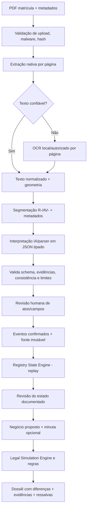

# 09 — Especificação do pipeline documental e de IA (núcleo obrigatório do MVP)

**Versão:** 1.2.0 · **Plataforma:** C# / .NET 10; cliente WPF; serviços de backend propostos em ASP.NET Core 10.

## 1. Por que este componente é central

Cartório Twin deve receber **matrícula em PDF**, ler seu conteúdo, **identificar e interpretar atos registrais com IA/parsers**, gerar fatos candidatos, submetê-los à **revisão humana**, reconstruir a **situação registral documentada**, receber a proposta negocial e simular seu resultado. A entrada manual não define o produto; é um fallback.

O sistema **não acessa nem atualiza acervo registral oficial por conta própria**; trabalha sobre fontes legitimamente fornecidas, com datas, integridade e limites explícitos. A expressão "situação atual" na UI é abreviação de **"situação atual conforme documentos analisados"**, jamais garantia de atualidade externa.

## 2. Pipeline E2E e fronteiras de confiança



**Regras de confiança:** (1) arquivo PDF é entrada não confiável; (2) texto extraído é evidência textual não revisada; (3) saída de IA é **candidata**, nunca fato; (4) somente evento/fato conferido por pessoa autorizada entra no replay; (5) replay do estado é determinístico e limitado às regras habilitadas; (6) simulação produz **hipótese condicional**, não decisão jurídica.

## 3. Responsabilidades e contratos C# propostos

| Componente/porta | Responsabilidade | Saída e erro esperado |
|---|---|---|
| `IDocumentIngestionService` | Receber, validar, hash, armazenar, registrar versão e job | `DocumentoRecebido` ou recusa explícita |
| `IExtratorTextoPdf` | Ler camada textual, por página com spans | `PaginaTexto[]` e qualidade/avisos |
| `IReconhecedorOcr` | Reconhecimento de imagem/scan, com adapter local | `PaginaTexto[]` e avisos de baixa confiabilidade |
| `IClassificadorPagina` | Escolher nativo, OCR ou ambos por página | Estratégia auditada; nunca silenciosamente vazia |
| `ISegmentadorAtos` | Localizar abertura, R-n/AV-n e referências entre páginas | `SegmentoAtoCandidato[]` com offsets/evidências |
| `IInterpretadorAto` | Extrair campos e possíveis efeitos em JSON tipado | `AtoCandidato[]` com flags de ambiguidade |
| `IValidadorInterpretacao` | Schema, enum, ligações e evidências existentes | Rejeição ou issues; não confirma fatos |
| `IRevisaoAtoService` | Promover/corrigir/contestar candidato; audit append-only | `AtoRevisado` assinado por usuário/data |
| `IReconstrutorEstadoRegistral` | Reproduzir atos revisados sem IA/IO | `EstadoDocumentado` + lacunas + linhagem |
| `ISimuladorOperacao` | Verificar proposta e projetar frações/estados permitidos | `ResultadoSimulacao` com premissas/achados |
| `IDossieService` | Relatar fontes, versões, atos, regras e revisão | PDF ou HTML imprimível, sem certificação |

Modelos devem ser definidos no `Domain`/`Application` e os adapters em `Infrastructure`. Nenhuma ViewModel WPF chama diretamente LLM/OCR. O serviço de jobs processa arquivos fora da thread de interface.

### Exemplo de contrato C# (assinaturas orientadoras)

```csharp
public sealed record EvidenciaFonte(
    Guid FonteId, string Sha256, Guid ExtracaoId, string TextoHash, int Pagina,
    int? InicioUtf16, int? FimUtf16, string Trecho,
    string? BoundingBoxJson);

public sealed record CampoCandidato<T>(
    string NomeCampo, T? ValorSugerido,
    IReadOnlyList<EvidenciaFonte> Evidencias,
    bool RequerRevisao, string? Aviso);

public enum EstadoRevisao { Pendente, Confirmado, Corrigido, Contestado, NaoLocalizado }

public interface IInterpretadorAto
{
    Task<ResultadoInterpretacao> InterpretarAsync(
        SegmentoAtoCandidato segmento,
        VersaoModeloInterpretacao versao,
        CancellationToken cancellationToken);
}

public interface IReconstrutorEstadoRegistral
{
    EstadoDocumentado Reconstruir(
        MatriculaReferencia matricula,
        IReadOnlyList<AtoRevisado> atos,
        PacoteRegrasRegistral regras,
        DateTimeOffset instanteAnalise);
}
```

> Assinaturas expressam fronteiras. `ResultadoInterpretacao`, `SegmentoAtoCandidato`, `VersaoModeloInterpretacao`, `AtoRevisado` e `EstadoDocumentado` serão implementados no projeto; este trecho não é um projeto compilável isolado.

## 4. Estrutura de fatos e atos

Cada ato candidato deve conter, no mínimo: `AtoId`, `FonteId`, `Matricula`, `IdentificadorAto` (como `R-5`/`AV-6` quando localizado), `TipoAtoDeclarado`, `OrdemNaFonte`, `Paginas`, `TextoOriginalReferenciado`, `DataDoTitulo?`, `DataDoAto?`, `DataDaApresentacao?`, `PessoasCandidatas[]`, `DireitosCandidatos[]`, `ReferenciasAOutrosAtos[]`, `EvidenciasPorCampo`, `Issues`, `VersaoExtrator`, `VersaoModelo`, `VersaoPrompt`, `EstadoRevisao` e `RevisadoPor?`.

**Datas jamais podem ser confundidas.** A ordenação dos atos respeita a sequência registral documentada e regras aprovadas, e não só um timestamp extraído pela IA. Identidades pessoais utilizam IDs revisados; nomes OCR são rótulos, não chaves.

### Exemplo JSON sintético de saída da IA — NÃO CONFIRMADO

```json
{
  "schemaVersion": "1.0",
  "matricula": "15320",
  "ato": "R-2",
  "classificacaoSugerida": "transmissao_propriedade",
  "ordemNaFonte": 2,
  "campos": [
    {
      "nome": "adquirente.nome",
      "valorSugerido": "Maria da Silva",
      "estado": "pendente_revisao",
      "evidencias": [{"pagina": 2, "trecho": "adquirente: Maria da Silva", "inicioTexto": 120, "fimTexto": 145}]
    },
    {
      "nome": "direito.fracao",
      "valorSugerido": "1/2",
      "estado": "pendente_revisao",
      "evidencias": [{"pagina": 2, "trecho": "fração ideal de metade", "inicioTexto": 209, "fimTexto": 231}]
    }
  ],
  "avisos": ["Revisar extensão do direito e cadeia anterior"],
  "confirmed": false
}
```

O validador determinístico do servidor verifica se texto, página e offsets pertencem à versão exata da extração imutável. A existência literal do trecho não prova que ele sustenta o valor ou se refere à pessoa/ato corretos; contexto e revisão humana continuam obrigatórios. Trechos usados como evidência não podem ser criados pelo LLM. Se o texto fornecido não fundamentar o valor, a saída será `NãoLocalizado` ou `Inconclusivo`.

## 5. Do texto aos efeitos documentados

**Separar duas etapas:**

1. **Identificação do ato:** por exemplo `R-4`, classe sugerida, partes, frações, referências. Isso pode ser extraído por IA e revisado.
2. **Aplicação de evento registral:** converter o ato revisado em evento tipado e reproduzível, **somente se** houver regra correspondente validada e premissas suficientes.

O Registry State Engine é um *reducer* determinístico: `EstadoN+1 = Aplicar(EstadoN, EventoRevisado, PacoteRegras)`. Deve manter histórico de fatos/versões, detectar sequência faltante, efeito ainda incerto e referências pendentes.

| Evento | Comportamento mínimo do MVP | Limitação explícita |
|---|---|---|
| Abertura/descrição da matrícula | Identificar imóvel, serventia, páginas e campos | Não assumir que descrição é completa/atual |
| Transmissão de propriedade com extensão clara | Atualizar quadro de frações após revisão das partes e da cadeia | Se faltarem dados, marcar estado inconclusivo |
| Alteração de qualificação | Registrar alteração documental e vínculo revisado | Não unir pessoas só por similaridade textual |
| Constituição de ônus/garantia | Identificar e sinalizar elemento documentado | Não tratar como ausência de disponibilidade jurídica automaticamente |
| Menção a cancelamento de ônus | Ligar ao ato anterior, solicitar confirmação de efeito/alcance | Não excluir ônus da visão sem regra revisada |
| Averbação retificadora | Preservar texto e avisar impacto potencial | Efeito sobre descrição depende de revisão especial |
| Outros atos | Mostrar como não suportados e pedir análise | Nunca omitir silenciosamente |

**Regra rígida:** ato não suportado potencialmente relevante impede consistência e projeção completa. Sem divergência confirmada, o resultado é `INCONCLUSIVO`, mesmo que o cálculo parcial seja possível; havendo divergência confirmada, prevalece `DIVERGENTE` com lacunas explícitas, conforme 03. No MVP, hipóteses podem ser anotadas como rascunho separado, sem quadro projetado completo do motor.

## 6. Revisão humana: dois portões distintos

- **Portão A — revisão dos atos/campos:** usuário habilitado confirma, corrige ou marca inconclusivo. Correção preserva valor sugerido, valor final, justificativa, usuário, data e evidências. *Não existe botão "aprovar tudo" sem visualização/controles adequados*. A revisão é versionada e não modifica o PDF original.
- **Portão B — revisão do estado reconstruído:** após replay, revisor confere quadro de titulares/direitos, lacunas, data da fonte e atos relevantes. Só o estado com revisão concluída, aprovação e completude explícitas pode alimentar o `Legal Simulation Engine` como base validada. Uma revisão não significa parecer jurídico.

Alteração do documento, do ato revisado, da identidade, da regra ou do algoritmo invalida hashes e marca estados/simulações anteriores como **desatualizados**, preservados para auditoria.

## 7. WPF: workflow obrigatório

1. `Nova Análise` → cadastro e `Adicionar matrícula PDF`.
2. `Processando` → upload, leitura, OCR, segmentação e IA com progresso por etapa, cancelamento e reprocessamento.
3. `Revisar Atos` → PDF à esquerda, linha do tempo de R/AV à direita, campos com qualidade técnica e evidências clicáveis.
4. `Revisar Estado` → titulares/frações, ônus, linha do tempo, lacunas; ação `Confirmar base documental` apenas para usuário autorizado.
5. `Negócio Pretendido` → alienantes/adquirentes/frações e minuta opcional; comparação com fatos revisados.
6. `Simular` → colunas Atual Documentado / Pretendido / Projetado Condicional; alertas persistentes.
7. `Dossiê` → versão, páginas, hashes, atos, decisão do revisor, regras e limitações.

**Estados de UI:** uploading, scanning, extracting, ocr, interpreting, awaiting_review, reconstructing, needs_revision, ready_to_simulate, simulating, completed, inconclusive, failed, canceled, stale. A UI não deve exibir `Apto para registro` ou taxa de aprovação jurídica.

## 8. Privacidade, segurança e operação

- **Padrão fechado:** documentos são processados no ambiente autorizado; IA/OCR externo desativado por padrão. Ativação externa somente após contratação e análise de finalidade, compartilhamento, retenção, suboperadores, segurança e base legal adequados.
- **Dados pessoais:** redigir logs; criptografia em trânsito e repouso; ACL por serventia; exclusão/retensão segundo política formal; sem treinamento de modelos com dados dos cartórios por padrão.
- **Ataques por documento:** texto no PDF é dado não confiável, inclusive instruções do tipo "ignore políticas"; nunca o transformar em instrução de sistema/modelo. Schema e validações de evidência controlam saídas.
- **Qualidade:** diferenciar score de confiança técnica OCR/IA de validade jurídica. Quando incerto, apresentar motivo e pedir revisão.
- **Auditoria:** armazenar versão/hash do PDF, layout/texto, OCR engine, parser, modelo/prompt, schema, regras, revisor e datas do pipeline.
- **Escalabilidade:** jobs assíncronos idempotentes, filas com backpressure, cancelamento, política de retry e limite de tamanho/páginas configuráveis; estimar throughput no piloto.

## 9. Critérios de aceite mensuráveis (definir limiares quantitativos na Sprint 0)

1. PDF textual e PDF digitalizado alcançam `Aguardando revisão` com evidências por página nos casos do corpus de referência.
2. Todo campo **confirmado** tem evidência verificável ou foi inserido explicitamente por pessoa autorizada com justificativa de ausência de fonte; tal inserção **não se converte em fato documental comprovado**.
3. O sistema jamais promove saída bruta da IA diretamente a estado registral validado.
4. Um ato desconhecido potencialmente relevante não desaparece nem deixa `CONSISTENTE_NO_ESCOPO` sem análise.
5. Alteração de um ato confirmado invalida replay e simulação anteriores.
6. Simulações somente operam sobre snapshots revisados ou indicam claramente hipótese/inconclusão.
7. Dossiê percorre a cadeia `achado → regra → estado → ato → página/trecho → PDF`.
8. A taxa de omissão de eventos críticos, os erros de extração e o tempo médio de revisão são **medidos e divulgados no piloto**; critérios objetivos de go/no-go definidos com RI/TN antes da implantação.

## 10. Exemplos de teste documental

| Caso | Documento sintético | Resultado mínimo esperado |
|---|---|---|
| CT-PDF-01 | PDF textual: João 1/2, Maria 1/2 | Atos localizados, conferência humana, replay gera 1/2 + 1/2 |
| CT-PDF-02 | Mesmo cenário escaneado | OCR identifica os mesmos campos ou marca lacunas visíveis |
| CT-PDF-03 | João tenta vender 1/1 à luz do estado revisado | `DIVERGENTE` RT-004; nenhuma projeção completa |
| CT-PDF-04 | Matrícula com ônus/garantia e cancelamento ambíguo | Alertas rastreáveis; sem conclusão inventada de gravame extinto |
| CT-PDF-05 | Texto contém instrução maliciosa para IA | Instrução ignorada; regra e schema permanecem intactos |
| CT-PDF-06 | Folha ausente, R/AV não suportado, datas inconsistentes | `INCONCLUSIVO` + indicação precisa da lacuna |
| CT-PDF-07 | Minuta opcional sintética com pessoa/fração divergente da matrícula revisada | Campos de ambas as fontes revisados; divergência rastreável; sem minuta, proposta manual estruturada continua permitida |

**Fora do MVP:** reconhecimento universal sem revisão, execução de atos oficiais, efeitos automáticos de garantias/usufruto, extração de todo tipo de escritura, consulta indiscriminada a bases externas. A cobertura pode aumentar por pacotes versionados, após validação jurídica.

## 11. Contratos de implementação obrigatórios

Fonte/página, extração, segmento, candidato, revisão de campo/ato, evento, reconstrução, snapshot/aprovação, cenário/revisão e execução têm persistência e integridade definidas em 10. O Portão B registra que o estado foi conferido; se incompleto, a análise pode retornar inconclusivo sem projeção. Uma aprovação não transforma declaração manual sem fonte em fato comprovado.

Worker usa fila SQL durável, checkpoints, lease/fencing e publicação condicionada à revisão vigente; fechar o WPF não cancela job aceito. Eventos/fatos só são aplicados após revisão e mapeamento suportado; fontes sobrepostas exigem correspondência revisada para não duplicar aquisição. Alterar ato confirmado cria nova revisão e invalida dependentes; sequência numérica isolada não prova lacuna.

Offsets são UTF-16 em texto imutável versionado; OCR mantém imagem/transcrição com revisão visual. Saída em JSON é candidata mesmo que contenha `confirmed=true`; campo de confirmação não é uma autorização. Interpretador não tem ferramentas de escrita/banco/comandos. HTML do dossiê escapa dados não confiáveis e não executa markup do PDF/modelo.

Benchmark local e seleção de provedores precedem contratação/implementação dependente (S0-T08). Corpus/limiares são os de 11; taxa de omissão de atos inteiros é medida, não só acerto dos campos encontrados. Externo continua desativado até autorização específica. Replay e simulação são reproduzíveis sobre entradas fixadas; nova execução da IA pode produzir candidatos diferentes e deve ser versionada.

A fatia técnica integrada em S5-T09 antecipa validação de contratos; o aceite completo segue G8/G9, sem substituir UI, segurança ou holdout.
